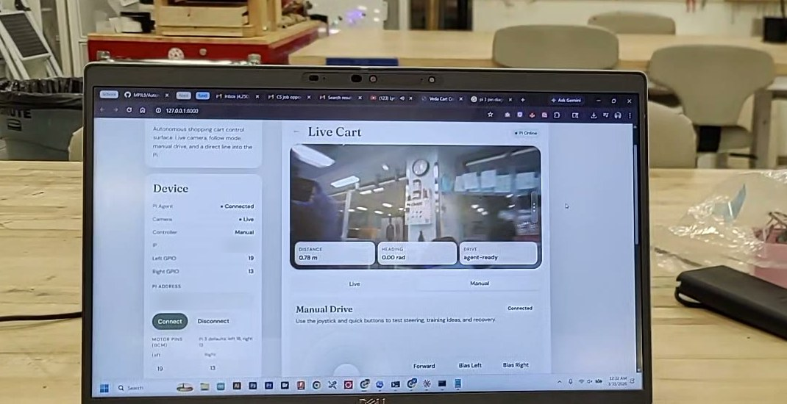
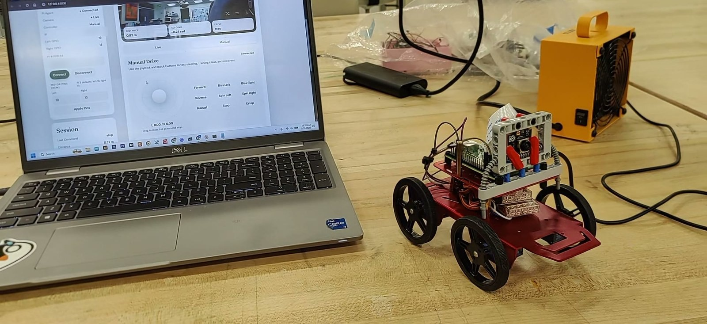
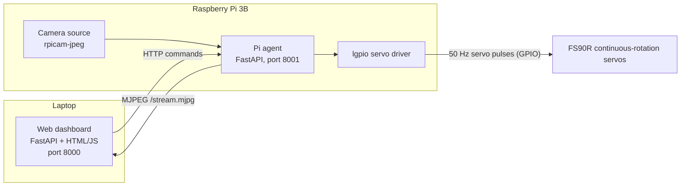
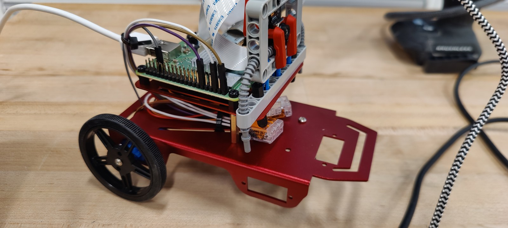
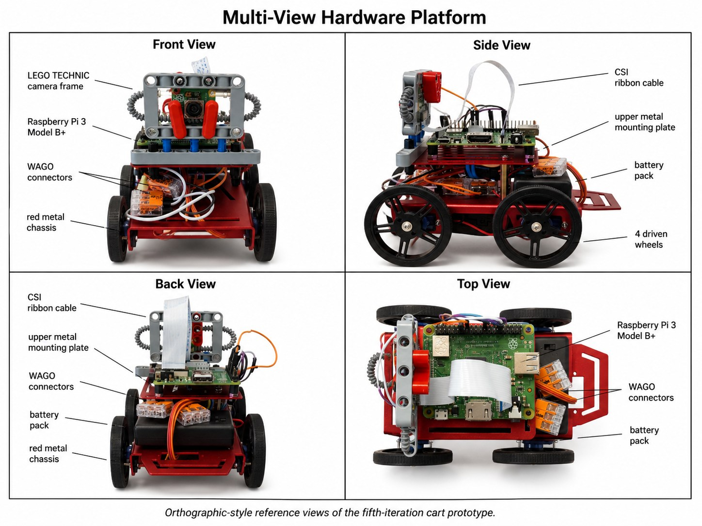
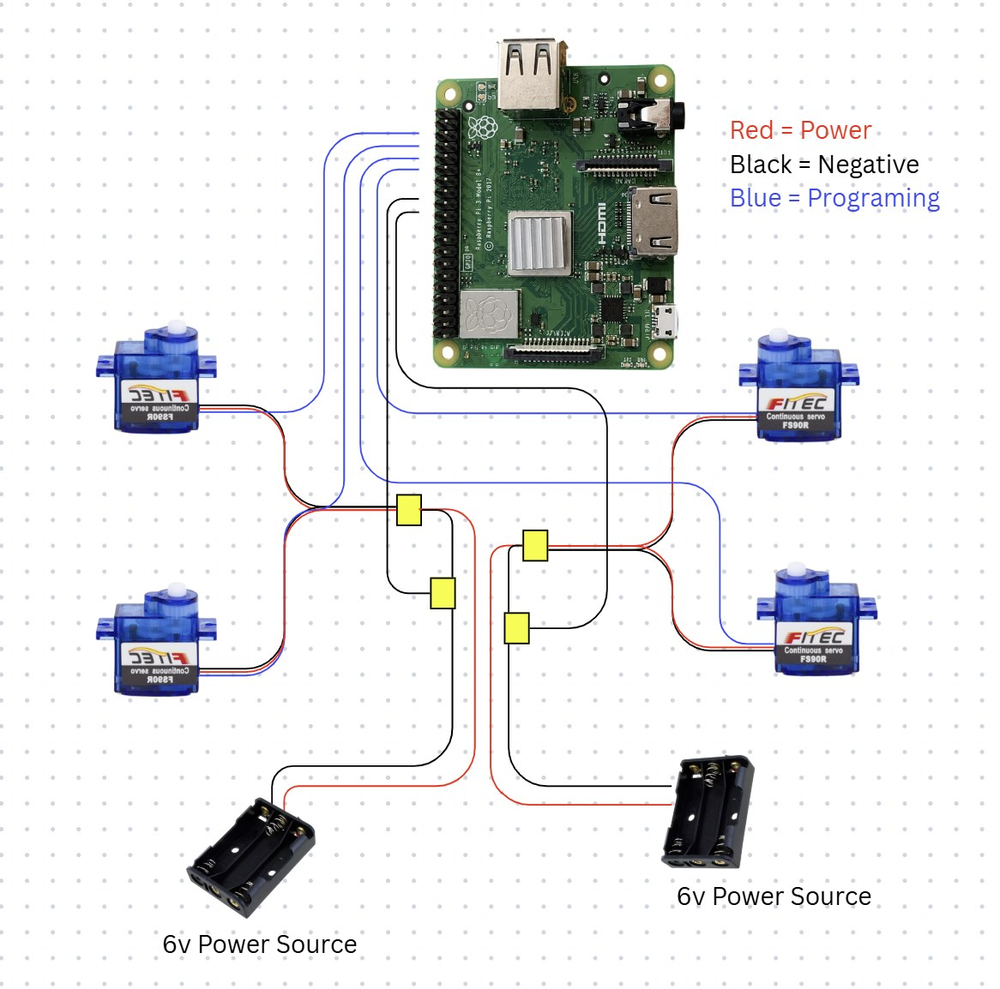

# Autonomous Cart: Hardware and Control System

**Vedarsh Mishra** · Team project with Tyler Potsiadlo and Tianxiang Liu · Boston College CSCI 3387 (Topics in Computational Intelligence), Spring 2026

This repository is the **original control platform** I built for our team's autonomous cart: a Raspberry Pi agent that drives the motors and streams the camera, a laptop web dashboard for connection and manual control, and the scripts that deploy everything to the Pi over SSH. It is the code as it existed on **March 30 – April 1, 2026**, developed locally before it was uploaded to the team repository ([MPJL9/Autonomous-Shopping-Cart](https://github.com/MPJL9/Autonomous-Shopping-Cart), commit of April 3, 2026). It was published as this standalone repository in October 2026.

The robot is a **15 cm tabletop research prototype**, not a full-size shopping cart. My teammates later built the perception, data-collection and learned-control software on top of this platform (see [Credits](#credits-and-project-context)). That work is not in this repository.

| Dashboard connected to the robot (Mar 31, 2026) | Manual drive test on the table (Mar 31, 2026) |
|---|---|
|  |  |
| Pi agent connected, camera live, controller in Manual, left/right servo signals on GPIO 19/13. | The four-wheel cart driving and turning under manual dashboard control (teleoperated, not autonomous). |

## What I built

- **Raspberry Pi bring-up.** Headless Raspberry Pi 3B with SSH over Wi-Fi, a setup script for GPIO and camera packages, and a systemd service definition for the agent.
- **Pi agent** (`cart_stack/agent/`). A FastAPI service on the Pi that accepts drive, stop, emergency-stop and configuration commands and serves the camera as an MJPEG stream.
- **Motor control** (`cart_stack/agent/motors.py`). Hardware-timed servo pulses through `lgpio`, with per-side trim and direction inversion, a stop deadband, and an option to stop pulsing at rest.
- **Camera streaming** (`cart_stack/agent/camera.py`). Pi camera capture with a fallback chain and automatic retry.
- **Web dashboard** (`cart_stack/dashboard/`). Laptop-side FastAPI server and browser UI ("Veda Cart"): connect to the Pi by IP, live camera, joystick and drive buttons, e-stop, a command terminal, and motor-pin and trim settings.
- **Deployment** (`scripts/`). One-command deploy from Windows to the Pi over SSH.
- **Hardware** (not code, documented here). Chassis and component integration across iterations, and the power-distribution redesign that fixed Pi brownouts.

## Timeline

| Date (2026) | Milestone | Evidence |
|---|---|---|
| Mar 17 | Earlier two-driven-wheel chassis: Pi 3B, camera ribbon, LEGO Technic camera mast | Photo and video |
| Mar 18 | Headless SSH into the Pi; first camera stream (H.264 over TCP, viewed in VLC); a camera-process crash followed by a reboot | Video (images 03, 04) |
| Mar 30 – Apr 1 | Pi agent, dashboard, servo driver and deployment scripts developed and run against the Pi | This code; dated working copy |
| Mar 31 | Four-wheel version driven manually from the dashboard | Video (images 01, 02) |
| Apr 3 | This code uploaded to the team repository | Team repository history |
| Apr – May | Teammates build perception and learned control on the platform. I maintain the hardware, replace cameras, and drive the cart manually for data collection. | Team final report |
| May 4 | Team final report | — |

## How it works



**Dashboard → Pi.** The dashboard normalizes the target you type (`mock`, an IP address, or `user@host`) into `http://<host>:8001`. It then calls the agent's HTTP API and proxies the camera stream at `/api/camera/stream`, so a teammate only needs the dashboard URL.

| Pi agent endpoint | Purpose |
|---|---|
| `GET /api/status` | Mode, e-stop, motor pins and trim, drive state |
| `POST /api/drive`, `/api/stop`, `/api/estop` | Left/right wheel commands in [-1, 1]; stop; emergency stop |
| `POST /api/mode`, `/api/target-gap` | Manual or auto mode; follow-distance setting (auto mode is a prototype, see below) |
| `POST /api/motor-pins`, `/api/motor-calibration` | Change GPIO pins, trim and deadband at runtime; saved to the Pi's `.env.pi` |
| `POST /api/command` | Terminal commands: `forward 0.4`, `spin_left 0.35`, `drive 0.2 0.5`, `stop`, `estop`, … |
| `GET /stream.mjpg` | MJPEG camera stream |

**Motor control.** Each command in [-1, 1] maps to a pulse width between 500 and 2500 µs at 50 Hz, after per-side inversion and trim. Commands inside the deadband (0.04 on the robot) become a full stop. Continuous-rotation servos drift around their neutral pulse, which made a "stopped" cart creep and jitter. With `CART_IDLE_PWM_MODE=off`, the driver stops pulsing at rest and holds the pin low instead of sending a neutral pulse. The configuration deployed on the robot is in [`.env.pi.example`](.env.pi.example): servo mode, left signal on GPIO 19, right on GPIO 13 (inverted), deadband 0.04, idle mode off. This version drove the left and right sides on one signal pin each. The final team build later used one signal per servo.

**Camera.** On March 18 the first stream was an H.264 feed over TCP, viewed in VLC (image 04). The agent in this repository captures JPEG frames with `rpicam-jpeg` (1280×720, at most one every 0.25 s) and serves them as MJPEG. After the camera process crashed during early testing, I added a fallback chain (rpicam → Picamera2 → OpenCV → synthetic frame) that retries the real camera every 5 s instead of freezing. The camera is an IMX708 Wide **NoIR** module; with no infrared filter, its colours have a purple/blue cast (image 05).

**Deployment.** `scripts/deploy_to_pi.ps1` archives the project, copies it to the Pi with `scp`, unpacks it, and runs `scripts/pi_setup.sh`. That script installs the GPIO and camera packages, creates a virtual environment, and registers `scripts/cart-agent.service`.

## Demonstrated on the robot vs. simulated

| Demonstrated on the physical robot | Simulated or mock | Prototype, not demonstrated |
|---|---|---|
| Headless SSH setup; Pi agent in servo mode; live Pi camera stream to the dashboard; manual driving from the dashboard (images 01–04) | Mock motor driver and synthetic camera for laptop testing. The dashboard's **distance, heading, FPS and latency readouts are computed from a motion model in this version, not measured**, including the `gap=… heading=…` overlay. Motion Lab planning math. | "Auto" follow mode and the OpenCV HOG person detector (`agent/vision.py`). **The autonomous person-following in our team results came from my teammates' later software, not from this code.** |

## Hardware

| Earlier build (Mar 17) | Fifth iteration (my four-view figure) | Power wiring (my diagram) |
|---|---|---|
|  |  |  |

- **Drivetrain.** The two-driven-wheel layout with a front pivot was unstable in turns. The final chassis drives all four wheels with FS90R continuous-rotation servos.
- **Power.** With the servos on the Pi's supply, the Pi browned out and reset when the cart started or turned, and the platform overheated. I moved the servos to two independent ~6 V packs (front and rear pairs) through WAGO connectors, gave the Pi its own 5 V supply, and tied all grounds together so the 3.3 V PWM reads correctly. Thermal measures: a heat sink and short sessions. **Rail voltage, servo current and Pi temperature were never measured.**

More images: [SSH session](docs/images/03_headless_ssh_mar18.jpg) · [first camera stream](docs/images/04_first_camera_stream_mar18.jpg) · [Pi camera frame](docs/images/05_pi_camera_frame_noir.jpg) · [mock-mode frame](docs/images/06_mock_mode_synthetic_frame.jpg)

## Running it

Requires Python 3.10+.

```bash
pip install -e .[dev]
python -m cart_stack.dashboard.run      # http://127.0.0.1:8000, then connect to "mock"
pytest                                  # 8 tests: motion math, target parsing, camera, mock backend
```

On a Raspberry Pi, copy `.env.pi.example` to `.env.pi`, deploy with `scripts/deploy_to_pi.ps1 -PiHost <pi-address> -PiUser <user>`, then run `scripts/pi_run_agent.sh`.

## Repository layout

```
cart_stack/
  agent/        Pi agent: app.py (HTTP API), motors.py (servo driver), camera.py, vision.py (prototype), run.py
  dashboard/    Laptop dashboard: app.py, runtime.py (Pi connection + proxy), static/ (UI), run.py
  shared/       commands.py (terminal parser), models.py (API models), physics.py (drive math)
scripts/        deploy_to_pi.ps1, deploy_to_pi_paramiko.py, pi_setup.sh, pi_run_agent.sh,
                cart-agent.service, start_dashboard.bat, motion_lab.py
tests/          test_physics.py, test_runtime.py, test_camera.py
docs/           images/, ORIGINAL_README_2026-04-01.md
.env.pi.example deployed Pi configuration (no secrets)
```

## Credits and project context

- **Course:** Boston College CSCI 3387, Topics in Computational Intelligence, Spring 2026. Team: Tyler Potsiadlo, Tianxiang Liu, Vedarsh Mishra.
- **Tianxiang Liu** built the later perception stack (ArUco/ChArUco calibration, YOLO-Pose), the data-collection pipeline and an expanded dashboard, and developed the behavior-cloning and AWR training and evaluation pipelines.
- **Tyler Potsiadlo** built the early reinforcement-learning frameworks and evaluated and selected the learned policies.
- Their work, including the final autonomous-following results, is in the team repository: [MPJL9/Autonomous-Shopping-Cart](https://github.com/MPJL9/Autonomous-Shopping-Cart). My original working copy also held early files from them (Tianxiang's `Jimmy/` CV folder; Tyler's RL notebooks and milestone PDF). Those are not included here and remain in the team repository.

## About this repository

- This code was developed locally in March–April 2026 and published to GitHub in October 2026. The original April 1, 2026 README is preserved in [`docs/ORIGINAL_README_2026-04-01.md`](docs/ORIGINAL_README_2026-04-01.md), with only the redactions below.
- **Changes made for the public version:**
  - Removed caches, build metadata and runtime logs.
  - Replaced two private network addresses with documentation addresses (192.0.2.10 / 192.0.2.20).
  - Removed a local Windows path.
  - Renamed the deployed `.env.pi` to `.env.pi.example`.
  - Blurred IP addresses in screenshots.
  - Replaced the Pi username with configurable placeholders. `cart-agent.service` now uses `__PI_USER__` / `__APP_DIR__`, which `pi_setup.sh` fills in at install time. The deploy scripts default to `pi` (override with `-PiUser` / `--user`).
- No other code was changed; all 8 tests pass.
